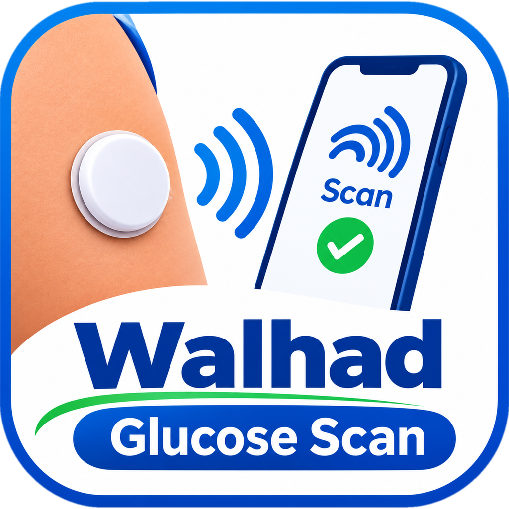
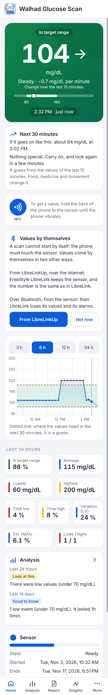
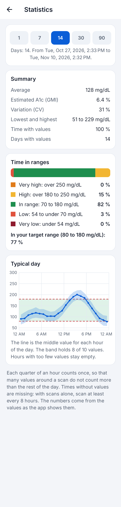
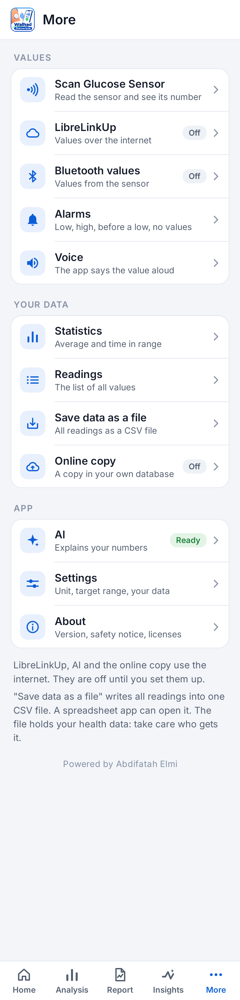
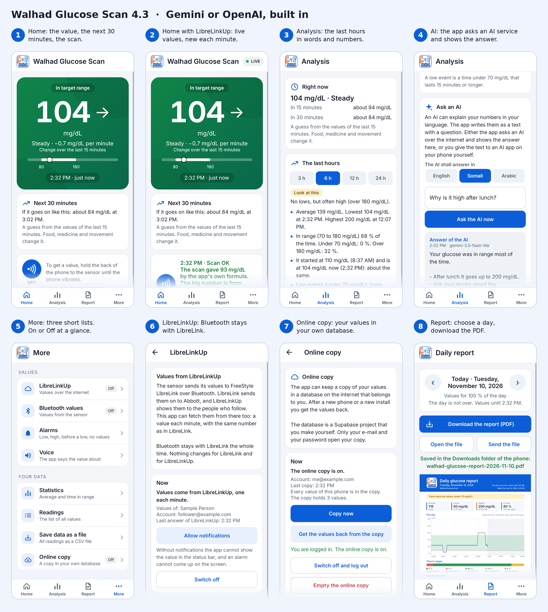

# Walhad Glucose Scan

## Download the app

**Walhad-GlucoseScan-v4.1.apk** — free, 1.7 MB, no account, nothing to pay.
Android 6.0 or newer. NFC is needed for scanning.

On the phone: tap the button, open the downloaded file, allow "install from this source"
for your browser, press **Install**. New versions install over old ones without losing
your values.

| | | |
| --- | --- | --- |
|  |  |  |

*This app is not a medical device. Keep LibreLink and its alarms on. It was never tried
with the real LibreLinkUp, AI or Supabase services — only with pretended ones.*

An Android app for the **FreeStyle Libre 2** sensor (European type). It shows the glucose
value in two ways: you **scan** the sensor with the phone (NFC), or the app **fetches the
values from LibreLinkUp** over the internet, one each minute, while the sensor stays
connected to FreeStyle LibreLink.

New in version 4.3: **the AI is built in, and there are two services to choose from:
Google Gemini and OpenAI.** Both are filled in by the app — the address and the model are
already there, so the only thing left is to paste a key. The button **Get a free key** opens
the page where that key is made. **Find models** asks the service which models it has and
marks the free ones; if the service cannot be reached, the models the app knows are offered
instead, with "free" next to Gemini's. OpenAI has no free models: it charges a small fraction
of a cent for one question here.

New in version 4.2: **the app speaks with a man's voice, and no ringtone is played any
more.** An alarm vibrates and *says* what it is about, every nine seconds, for half a
minute. The report carries "Powered by: Abdifatah Elmi" at the bottom of both pages. The
AI now asks a model that really exists (see "Version 4.2" below).

New in version 4.1: **a new look.** Calm, light screens with one brand colour; the app's
own letters (Inter), so that it looks the same on every phone; "More" as three short
lists; fields and buttons of one kind. The button "Correct the value" left the Home screen
(it is under More → Settings now). Nothing else changed: the values, the alarms and the
three online things work as in 4.0.

From version 4.0: the app can use the internet. It does so for three things, and for each
one only after you have set it up:

- **Values from LibreLinkUp.** A value each minute, with the same number as in LibreLink.
  Bluetooth stays with LibreLink the whole time, so LibreLink and LibreLinkUp go on working,
  with their alarms.
- **The AI inside the app.** "Ask the AI now" sends your numbers to an AI service (Google
  Gemini, OpenAI or another one) and shows the answer in the app, in English, Somali or
  Arabic. You need a key of the service; Gemini has a free level.
- **Online copy.** Your values are copied to a database on the internet that belongs to
  you (a Supabase project). A new phone gets them back.

Without these three the app works as before and sends nothing. See "What goes over the
internet".

From version 3.0: the Home screen with the line under the value, **"Next 30 minutes"** with
the warning before a low, the **Analysis**, the **daily report** as a PDF. The diary is
gone since 3.0.

From version 2.0: **voice**, **live values over Bluetooth**, **alarms**, **statistics**,
**saving all data as a file**.

Powered by **Abdifatah Elmi**. Walhad is his brand.

The Android app is written new in Kotlin. The way to read and decode the sensor comes
from the open-source iPhone app [Glucose Direct](https://github.com/creepymonster/GlucoseDirect)
(MIT license) and was checked against it by a machine (see "What was tested"). The list of
new things in version 2.0 follows the Android app [Juggluco](https://www.juggluco.nl/Juggluco/index.html).
No code of Juggluco is in this app. The forecast, the analysis and the report of version
3.0 are new code of this app. So is everything of version 4.0; how to ask LibreLinkUp was
learned from open-source projects that have done it for years (see "Credits and license").

A report made from made-up values: [docs/screenshots/sample-report.pdf](docs/screenshots/sample-report.pdf).

## Please read this first

- This app is **not a medical device**. Nobody has tested or approved it.
- **It was built and tested on a computer.** On a real phone with a real sensor only the
  scan was tried, by one person, with version 1.2: the scan worked, and the number was not
  the same as in LibreLink (see "Why the number differs from LibreLink").
- **Nothing that is new in version 2.0, 3.0 or 4.0 was tried on a real phone or with a real
  sensor**: not the live values over Bluetooth, not the alarms, not the voice, not the
  forecast, not the analysis, not the download of the report.
- **Nothing of version 4.0 was tried with the real services.** LibreLinkUp, the AI services
  and Supabase were pretended in the tests, built after their public descriptions. The app
  has never talked to the real ones. Expect that something needs fixing; each of the three
  screens has a text to copy for the person who helps with the app.
- **The way to LibreLinkUp is not from Abbott.** Abbott has not published it and has not
  allowed it, and can change its servers any day. Then the values stop until the app is
  changed.
- **Keep the alarms of FreeStyle LibreLink switched on.** With LibreLinkUp the alarms of
  this app need the internet twice (LibreLink must send, this app must fetch). The alarms
  of LibreLink need no internet.
- **An AI can be wrong.** It does not know you, your medicines or your food, and it can
  ignore what it is told. Do not change insulin or medicine because of an AI.
- **The forecast and the warning before a low are a guess.** They continue the last 15
  minutes as a straight line. The warning can come when no low follows, and it can miss a
  low, above all a fast one. With scans alone it can only show up right after a scan.
- **The analysis counts; it does not think.** It is not a doctor and not an AI. It gives no
  advice about insulin, medicine or food.
- **Do not rely on the alarms of this app.** If you need alarms you can trust, keep the
  alarms of FreeStyle LibreLink: use LibreLinkUp for the values of this app, not Bluetooth.
  Live values over Bluetooth take the sensor away from LibreLink: see "Live values over
  Bluetooth".
- Compare the values with a blood glucose meter (finger prick), the FreeStyle LibreLink app
  or the Libre 2 reader. Do this for some days, with low, normal and high values, before
  you rely on the app for anything.
- Do not decide about insulin, food or other treatment from this app alone.
- **The update from version 2.0 deletes the diary.** If you need the entries, save them
  with version 2.0 first: see "Install".

## What it does

The scan, as before:

- Reads the sensor when the back of the phone is held to it. One scan gives:
  - one value for each of the last 15 minutes,
  - one value for each 15 minutes of the 8 hours before that.
- Shows the newest value, an arrow, a chart (3, 6, 12 or 24 hours) and a list of readings.
- mg/dL or mmol/L. A value inside the target range stands on a green card, a value outside
  of it on a red card; the card also says it in words. Below 40 mg/dL it shows LOW, above
  500 mg/dL it shows HIGH.
- Shows the sensor: state, start, end, age, time left, serial number.
- "Correct the value" (More → Settings): you type the number of your finger-prick meter
  (or of LibreLink), and the app corrects the values of this sensor with it. See below.
- Light and dark mode. English only.
- Keeps the values for 90 days, on the phone only. The app has no internet permission.

From version 2.0:

- A bar at the bottom with four screens. In version 3.0 they are Home, Analysis, Report
  and More.
- A scan works on every screen of the app, not only on Home. After the scan the app shows
  Home.
- Voice, live values, alarms, statistics, a file with all data. Each has its own part
  below.

New in version 3.0: the new Home screen, the forecast, the analysis, "Ask an AI" and the
daily report. Each has its own part below.

## What it does not do

- **It cannot scan by itself.** NFC works only while the phone touches the sensor. Values
  come by themselves from LibreLinkUp or over Bluetooth: see "Values from LibreLinkUp" and
  "Live values over Bluetooth".
- **There is no AI inside the app.** The app can ask an AI service over the internet, with
  your key. See "AI".
- No diary: nothing about insulin, food or finger pricks can be written down in the app.
- From a scan or over Bluetooth it cannot show exactly the same number as LibreLink. See
  "Why the number differs from LibreLink". With LibreLinkUp the number is the one of
  LibreLink.
- It does not start a sensor. Start a new sensor with the FreeStyle LibreLink app or the
  Libre 2 reader, then scan it with this app.
- **A scan only reads.** Live values change one thing in the sensor: to which app it sends
  its values over Bluetooth. The app does this only after you switch live values on.
- Only Libre 2 of the European type (the app names this type "Libre 2 EU"). Libre 1,
  Libre 2 US/CA, Libre 3, Libre Pro and other sensors are refused with a message.
  Glucose Direct also counts some newer sensors (Libre 2 Plus) as "Libre 2 EU"; this app
  does the same, but that was not checked with real data.
- No Nightscout, no Health Connect, no widget, no watch. No web page that shows the values:
  the online copy is a plain table in your own database.
- No alarms from scans alone: the app must get values by itself to warn you.
- It is not in an app store, and it does not update itself.

## Install

1. The phone needs Android 6.0 or newer and NFC. Switch NFC on.
2. Copy `Walhad-GlucoseScan-v4.1.apk` to the phone and open it there.
3. Android asks if this source may install apps: allow it. If Play Protect warns about an
   unknown app, choose to install anyway.

If an older version of Walhad Glucose Scan is on the phone, do not remove it. Version 4.1
installs over it and keeps the saved values, the correction and the settings. Android
shows that the app now may use the internet; nothing is sent before you set up one of the
three online things.

**An update from version 2.0 deletes the diary entries** (insulin, carbohydrates, finger
pricks, notes): since version 3.0 the app has no diary. They cannot be brought back. To
keep them, do this in version 2.0 before the update: More → "Save data as a file". That
file holds the diary entries too.

## Use

1. Open the app. Read the notice, choose the unit, tick the box, press "Start".
2. Hold the back of the phone to the sensor and keep still.
   - One vibration: the scan worked. The app says the value (you can switch that off under
     More → Voice).
   - Three short vibrations: there was a problem. The red text says which.
3. The NFC antenna is in a different place on each phone, often near the camera or in the
   middle of the back. Move slowly until the phone reacts.
4. If the LibreLink app is on the same phone: open Walhad Glucose Scan first, then scan.
   While it is open, the scan goes to Walhad Glucose Scan.

If a scan does not work: More → About → "Technical details of the last scan" → "Copy", and
send the text to the person who helps with the app. The text holds sensor data (serial
number and the sensor memory).

## Values from LibreLinkUp

More → LibreLinkUp. **Off from the start.**

The sensor sends its values to FreeStyle LibreLink over Bluetooth. LibreLink sends them on
to Abbott's servers. The LibreLinkUp app of a follower shows them. This app asks the same
servers the same questions as the LibreLinkUp app, once a minute. Bluetooth stays with
LibreLink.

What you need:

- FreeStyle LibreLink on the phone at the sensor, with internet, and with sharing switched
  on: in LibreLink open the menu → "Connected apps" → "LibreLinkUp" and invite the e-mail
  address of a follower.
- A LibreLinkUp account that has accepted this invitation, in the LibreLinkUp app. It can
  be your own second e-mail address.
- Internet on the phone with this app. Both apps can be on the same phone.

How to switch it on:

1. More → LibreLinkUp. Type the e-mail and the password of the **LibreLinkUp** account
   (not of the LibreLink account). Press "Connect".
2. If the account follows several people, choose one.
3. Allow notifications (Android 13 and newer) and "Allow background use".

While it is on:

- **Every screen shows the numbers of LibreLinkUp**: Home, chart, forecast, statistics,
  analysis, report, readings, the data file. They are the numbers of Abbott's own program.
  The app does not change them.
- The values the app has read itself (scans, Bluetooth) are kept apart and are shown again
  when LibreLinkUp is switched off. The two kinds are never mixed: they are calculated in
  different ways, and a chart that jumps between them would show ups and downs that never
  happened.
- "Correct the value" is not used and not shown.
- A scan still works. It only reads. Home then says what the scan gave "by the app's own
  formula", next to the big number from LibreLinkUp.
- The arrow and the change per minute are counted by this app from the values of the last
  15 minutes, as always. They can differ from the arrow in LibreLink. Right after switching
  on, the arrow can be missing for some minutes.
- The value stays in a notification; the alarms and the voice work as with Bluetooth
  values. "LIVE" stands at the top of Home while fresh values come.
- LibreLinkUp and Bluetooth values are never on together. Switching one on switches the
  other off, after a question.

What the app does so that the account stays safe:

- One question a minute, a few seconds after the next value is due. Not more.
- The password is saved on the phone, locked with a key that only this phone has (Android
  Keystore). It is needed each time the login runs out. "Switch off" removes it.
- A password that the server refuses is never tried a second time: a few wrong tries lock
  a LibreLinkUp account. The app stops asking and tells you.
- When the server says "wait", the app waits that long. When the server answers with
  errors, the app asks less and less often, in the end every 10 minutes.
- When Abbott wants its terms of use or its privacy notice accepted again, the app asks
  you. It never says yes by itself.

Limits:

- **Not official**, see "Please read this first". Other apps have used the same way for
  years (xDrip+, Juggluco, GlucoDataHandler, Nightscout); it has broken before when Abbott
  changed something, and was repaired by changing the apps.
- No internet, no values. The screen and the notification then say "No internet" or
  "LibreLinkUp has no new value" (LibreLink has sent nothing).
- At the start LibreLinkUp gives the newest value and the last 12 hours in steps of 15
  minutes. Older days are not there; the statistics grow from then on.
- While the phone sleeps, the app asks Android to wake it at the exact time of the next
  question. Phones that save battery hard may still stop it: allow background use. How well
  this works over a night, and what it costs in battery, was not tried on a phone.
- If the LibreLinkUp app gets logged out when this app logs in with the same account,
  invite a second e-mail address in LibreLink and use that one here. (Not tried.)

## Home

- The big card: the newest value, the arrow, the direction in words, and the change per
  minute. Under it a line from 40 to 300 mg/dL (or more, if your range is higher): the
  light piece is your target range, the dot is the value.
- "Next 30 minutes": see "Forecast and the warning before a low".
- The NFC card, the chart (3, 6, 12 or 24 hours).
- "Last 24 hours": time in your target range, average, lowest and highest value.
- "Analysis": one sentence about the last 24 hours and one about the last days. Tap the
  card to open the Analysis screen.
- The sensor: state, start, end, and a bar for the time that is used up.
- With live values on, the top of the screen shows "LIVE" (or "WAITING", "PROBLEM").
  With live values off, a card "Values by themselves" offers to set them up.
  "Not now" puts the card away; live values stay under More.

## Forecast and the warning before a low

The app lays a straight line through the values of the last 15 minutes and continues it
for 30 minutes.

- Home shows it as a sentence, "If it goes on like this: about 84 mg/dL at 3:02 PM", and
  as a dotted line in the chart. Analysis shows the numbers for 15 and for 30 minutes.
- If the line goes below your target range within 20 minutes, and the values fall by at
  least 0.5 mg/dL a minute, the card turns yellow: "It may go below your target range
  (80 mg/dL) in about 12 minutes."
- The direction then reads "Falling slowly", not "Steady". The arrow stays as it is: the
  arrow "steady" means a change of less than 1 mg/dL a minute, so it covers a slow fall.
  The same words are used for a value that is below the range and still falling.
- The voice adds "Below target soon." (More → Voice; can be switched off.)
- With live values on, an alarm can ring before the low: More → Alarms → "Before a low".
  It is off from the start. See "Alarms".

There is no forecast when the app knows too little: fewer than 5 values, values that
reach back less than 8 minutes, a newest value older than 5 minutes, values that jump
around the line, or a new sensor in between. A correction never hides a coming low: the
app also continues the sensor values without the correction, and the earlier of the two
warnings counts.

**It is a guess.** Glucose does not move in straight lines. Food, insulin, medicine and
movement change it. Without live values the app gets values only when you scan, so it can
warn only right after a scan. Do not wait for the warning: if you feel low, measure.

## Analysis

The second screen in the bar at the bottom. Everything is counted on the phone, by fixed
rules; the same values always give the same sentences.

- **Right now**: the value, the direction, the forecast for 15 and 30 minutes.
- **The last hours** (3, 6, 12 or 24): what happened, in sentences, and each hour with
  its average, its lowest and its highest value.
- **Day by day**: the last 7 days with average, time in range, lowest and highest value,
  low events, and a bar for low, in range and high.
- **The last days** (1, 7, 14, 30 or 90), and for them:
  - **What stands out**: sentences, each with a level: "Talk to your doctor", "Look at
    this", "Good to know" or "Good". For example low events and when they start, the time
    of day with the highest values, a rise or fall in the early morning, more or less
    time in range than in the same time before.
  - **Common goals**, reached or not reached: in range (70 to 180 mg/dL) 70 % or more;
    under 70 less than 4 %; under 54 less than 1 %; over 180 less than 25 %; over 250
    less than 5 %; variation (CV) 36 % or less. These are the goals of the international
    agreement of 2019 for most adults with diabetes. A doctor may set other goals.
  - **By time of day**: night, morning, afternoon, evening.
  - **Low events**: each time under 70 mg/dL that lasted 15 minutes or longer.
- "Daily report with graphs (PDF)" and "More numbers: statistics" open those screens.

The sentences about the last days need the values of 12 hours or more. If there are
values for less than 70 % of the time, the app says that the numbers can be far off.
Like the statistics, the analysis counts each quarter of an hour once, and it uses the
values as the app shows them (with your correction).

The analysis only describes. It does not say why something happened and not what to do.
Show the screen, or the report, to your doctor or diabetes nurse.

## AI

At the end of the Analysis screen. The app writes the numbers of the chosen days as a text
with a question. There are two ways to get an answer.

**1. The app asks an AI service itself (new in 4.0).**

1. More → AI. Choose the service, paste its key, press "Save".
   - **Gemini** (Google): the key comes from `aistudio.google.com/apikey`. There is a free
     level. On the free level Google may use what is sent to make its products better.
   - **OpenAI**: the key comes from `platform.openai.com/api-keys`. OpenAI charges for
     each question.
   - **Other**: any service that understands the same questions as OpenAI
     ("OpenAI-compatible"), for example Groq, OpenRouter or Mistral. Type its address.
   - "Find models" asks the service which models the key can use. Model names change often;
     if the app says that the service does not know the model, choose another one here.
2. Analysis → choose the language of the answer (English, Somali, Arabic) → "Ask the AI
   now". You can type an own question first.
3. The answer appears under the button, with its time and the model. It stays there until
   the next answer.

**2. You give the text to an AI app (as in 3.0).** "Send to an AI app" or "Copy the text".
Nothing is sent by the app itself this way.

What is sent to the AI service: rules for the answer (plain words, no doses, no diagnosis),
the text that "Show the text" shows, and your own question. The text holds the numbers of
the period (summary, time in ranges, times of day, low and high events, day by day, the
last 24 hours hour by hour). It does not hold your name or the serial number of the sensor.

- The numbers go to the company of the AI service. The app cannot take them back.
- **An AI can be wrong**, and it can ignore the rules. Do not change insulin or medicine
  because of it. Ask your doctor.
- The key is saved on the phone, locked (Android Keystore). It is not in the code of the
  app and not on GitHub. Whoever has the key can ask at your cost: give it to nobody.
- The app sends only the model name and the two texts, nothing that only some models know.
  So it works with old and new models. It was never tried with a real service.

## Online copy

More → Online copy. **Off from the start.**

The app can keep a copy of your values in a database on the internet that belongs to you:
a [Supabase](https://supabase.com) project (a Postgres database with a login in front).
After a new phone or a new install, "Get the values back from the copy" brings the last 90
days back.

Once, make the database:

1. Open `supabase.com`, make an account and a new project. This is free.
2. In the project open "SQL Editor", paste the set-up text and press "Run". The text is in
   the app (More → Online copy → "Copy the set-up text") and in the file
   `app/src/main/res/raw/supabase_setup.sql`. It makes one table, `glucose_values`, and the
   rules that let each person see only the own rows.
3. Press "Connect" at the top of the project page. Copy the "Project URL" and the
   "Publishable key" into the app.

Then, in the app:

1. Choose an e-mail and a password for your copy and press "Create account". The database
   may send an e-mail: open the link in it once. (The page that opens may show an error;
   that does not matter.)
2. Press "Log in". The first copy is made at once.

After that the app copies new values by itself: when you open it, after a scan, and about
every 15 minutes while values come by themselves. "Copy now" does it at once.

Good to know:

- A row holds: the time, the value in mg/dL, where it came from (0 = read by the app, 1 =
  LibreLinkUp), the kind (one-minute or 15-minute value), the change per minute, the serial
  number of the sensor. Not your name.
- The "Publishable key" is not a secret. What opens your copy is your e-mail and password;
  the rules of the table keep everybody else out, also other accounts in the same project.
- The password and the logins are saved on the phone, locked (Android Keystore). "Switch
  off and log out" removes them.
- The phone keeps values for 90 days. The copy keeps them until you press "Empty the online
  copy".
- A free Supabase project falls asleep after a week without use. The app uses it each day
  while the copy is on. If it sleeps, open `supabase.com` and wake it.
- There is no web page that shows the values. You can look at the table in the Supabase
  dashboard ("Table Editor").

## What goes over the internet

Only these three, only to these places, only over `https`. No statistics about you, no
advertising, no other server.

| What | Where to | What is sent | When |
|---|---|---|---|
| Values from LibreLinkUp | Abbott's LibreView servers: `api.libreview.io` and its sisters for the regions (`api-eu.libreview.io` …) | For the login: e-mail and password of the LibreLinkUp account. After that only questions. Nothing is uploaded. | Once a minute while it is switched on |
| AI | The service you chose: `generativelanguage.googleapis.com` (Gemini), `api.openai.com` (OpenAI), or the address you typed | The key. The text with your glucose numbers and your own question. | Only when you press "Ask the AI now" or "Find models" |
| Online copy | Your own Supabase project | E-mail and password of your account there. Your glucose values with their times and the serial number of the sensor. | When you open the app, after a scan, about every 15 minutes while values come by themselves |

## Daily report

The third screen in the bar at the bottom.

1. Choose the day with the arrows. The app starts with today.
2. The screen shows the two pages as they will be in the file.
3. "Download the report (PDF)". The file `walhad-glucose-report-YYYY-MM-DD.pdf` goes into
   the **Downloads** folder of the phone (Android 10 and newer; no permission is needed).
   You find it in the Files app. On Android 9 and older, Android asks where to put it.
4. "Open the file" opens it in the PDF app of the phone. "Send the file" gives it to
   another app, for example WhatsApp or e-mail.

What is in it (A4, two pages):

- Page 1: the day in one sentence; average, lowest, highest, time in range; the chart of
  the day with the range 70 to 180 mg/dL; time in the five ranges; "How the day was" in
  sentences; what stands out.
- Page 2: a bar for each hour (lowest to highest, with the average); a table of the 24
  hours; the day and the six days before; how the numbers are counted.

Good to know:

- A day that is not over yet gives a report up to now, and the report says so.
- "In range" in the report always means 70 to 180 mg/dL, so that a doctor can compare it
  with other reports. Your own target range of the app is named at the end of page 2.
- Percent numbers from 10 % on are whole numbers that add up to 100. Under 10 % they have
  one decimal, so that a short low does not become "0 %".
- If the phone cannot make the PDF in the usual way, the app writes the file itself, each
  page as a picture. Such a file looks the same, but the text in it cannot be searched or
  marked.
- Downloading the same day again makes a new file; the phone adds a number to the name.
- The report is not from a doctor and not checked by one. It holds your health data: take
  care who gets it.

## Voice

More → Voice.

- "Say the value after every scan" is on from the start. The app says, for example,
  "Glucose 104. Steady." If the value is outside your target range it says so too:
  "Glucose 60. Below target. Falling."
- "Say the direction too" can be switched off. Then it says only "Glucose 104."
- New in 3.0: "Say 'Below target soon'" is on from the start. When the forecast goes below
  your target range, the app says, for example, "Glucose 88. Falling slowly. Below target
  soon."
- With live values on, the app can say the value by itself every 5, 15, 30 or 60 minutes.
  This is off from the start.
- "Say what an alarm is about": after the alarm tone the app says "Low glucose alarm. 60."
- "Test the voice" says an example.

The voice is the voice of the phone (Android "text-to-speech"). It uses the media volume.
The words are English. If the voice of the phone has no English, the app says the number
only. If the phone has no voice at all, nothing is said; the screen says so after the test.

## Live values over Bluetooth

More → "Bluetooth values". **Off from the start.** In the app this screen is called "Live
values".

**If LibreLink and LibreLinkUp must go on working, do not use this. Use "Values from
LibreLinkUp".** The two are never on together.

A Libre 2 sensor can send a value each minute over Bluetooth, but only to one app. When
this app takes the connection:

- FreeStyle LibreLink gets **no more values over Bluetooth and its alarms stop**;
- LibreLink can still scan;
- LibreLinkUp gets new values only when you scan with LibreLink.

To give the connection back: switch live values off in this app, then scan the sensor with
LibreLink. Then check in LibreLink that its alarms work again. (This way back is how other
apps of this kind describe it. It was not tried with this app.)

How to switch it on:

1. More → Live values → the switch. The app asks once more. Press "Switch on".
2. Android asks for permissions. Allow them:
   - "Nearby devices" (Android 12 and newer): Bluetooth.
   - "Location" (Android 11 and older): those Android versions do not let an app search
     for Bluetooth devices without it. Location must also be switched on in the phone.
     The app never reads the location.
   - "Notifications" (Android 13 and newer).
3. Scan the sensor once. This scan tells the sensor to send to this app. The sensor must
   be running (not ended, not failed).
4. The phone now looks for the sensor and connects. This can take a few minutes. Home
   shows a line about the connection; More → Live values shows more.

While live values are on:

- A notification stays in the bar at the top. It shows the newest value, also as a small
  number where the phone shows icons. The connection goes on while the app is closed and
  the screen is off, and it starts again after the phone was switched off and on.
- Many phones stop apps to save battery. Then the values and the alarms stop too.
  More → Live values → "Allow background use" asks Android to leave the app alone. On some
  phones (Xiaomi, Huawei, Samsung, Oppo and others) more settings of the phone maker are
  needed; the app cannot change those.
- Scanning works as before. A scan also fills the 8 hours before with values.
- If the sensor does not answer any more (for example because LibreLink scanned it), the
  app says so and asks for a scan.

**This part was never tried with a real sensor.** The bytes that go to the sensor and
come from it are the same as in Glucose Direct; a machine checked that. How Android's
Bluetooth is used is new code. If it does not work on your phone, the scan still works;
More → Live values → "Technical details" → "Copy" gives a text for the person who helps
with the app.

## Alarms

More → Alarms. **Alarms work only while values come by themselves**: from LibreLinkUp, or
over Bluetooth.

| Alarm | From the start | Can be set |
|---|---|---|
| Low glucose | on, below 70 mg/dL | 55 to 120 mg/dL |
| High glucose | off, above 250 mg/dL | 130 to 400 mg/dL |
| No values | on, after 20 minutes without a value | on or off |
| Before a low (new in 3.0) | off | on or off |

- An alarm plays the alarm tone of the phone for 20 seconds, at the alarm volume, and the
  phone vibrates. A notification says what it is about. Then the voice says it (see Voice).
- While the reason stays, the alarm comes again every 15 minutes.
- "Silence for 30 minutes" on the notification keeps that alarm quiet for 30 minutes.
- The low alarm looks at the sensor value and at the corrected value. If one of them is
  below the limit, it rings. A correction cannot hide a low value from the alarm.
- A sensor that has ended gives no "no values" alarm. The notification says that the sensor
  has ended.
- "Before a low": rings when the forecast goes below the **low alarm limit** within 20
  minutes (see "Forecast and the warning before a low"). The notification says "Low
  glucose soon: 86 mg/dL", the voice "Low glucose soon. 86." It rings at most once in 30
  minutes. Once the value is below the limit, this alarm stops; then the low alarm rings,
  if it is on. It is a guess: it can ring when no low comes, and it can miss a fast low.
- "Test the alarm sound" plays the sound. Use it to hear how loud it is, also with the
  phone set to silent or to "Do not disturb": what the phone does then depends on the
  phone and its settings.

With LibreLinkUp the alarms look at the numbers of LibreLinkUp. They can be late: by the
time LibreLink needs to send a value and this app needs to fetch it, and longer if the
phone sleeps or the internet is slow. Without internet only the "no values" alarm rings,
after 20 minutes.

**These alarms are a help only.** They can fail: the phone is out of reach of the sensor,
switched off, silent, without internet, or it has stopped the app. When the phone sleeps deeply, the "no
values" alarm can come some minutes late. The alarms were never tried on a real phone.

## Statistics

More → Statistics (also the button at the end of the Analysis screen). For the last 1, 7,
14, 30 or 90 days:

- Average, lowest and highest value, variation (CV).
- Estimated A1c ("GMI", glucose management indicator): 3.31 + 0.02392 × average in mg/dL.
  It is marked as rough if there are fewer than 14 days, or values for less than 70 % of
  the time.
- Time in ranges: very low (under 54 mg/dL), low (54 to under 70), in range (70 to 180),
  high (over 180 to 250), very high (over 250). And the time in your own target range.
- "Typical day": for each hour of the day the middle value of all days, and a band that
  holds 8 of 10 values.

Each quarter of an hour counts once, so that the many values around a scan do not count
more than the rest of the day. Times without values are missing from the numbers. With
scans alone, scan at least every 8 hours; then there are no gaps. The numbers are made
from the values as the app shows them (with your correction, if there is one). They are
not the numbers of LibreView and can differ from them.

## The diary was removed

Version 2.0 had a diary for insulin, carbohydrates, finger pricks and notes. Version 3.0
has none: the screens, the letters on the chart and the diary rows of the file are gone.
The update deletes the saved diary entries (see "Install"). "Correct the value" is still
there; it never used the diary.

## Save all data as a file

More → "Save data as a file". Android asks where to save. The file
`walhad-glucose-YYYY-MM-DD.csv` holds all saved readings. A spreadsheet app can open it.
The columns are: kind, time, mg/dL, mmol/L, sensor value mg/dL (the value without your
correction), note, sensor.

The app itself still has no internet permission and sends nothing. The file holds your
health data: take care who gets it.

## Why the number differs from LibreLink

This is about the values the app reads itself, by a scan or over Bluetooth. **With "Values
from LibreLinkUp" the app shows the number of LibreLink.**

The sensor does not send a glucose value. It sends raw measurements, and each app has to
calculate the value from them.

- LibreLink calculates with Abbott's own program. That program is not public and belongs to
  Abbott. It cannot be put into this app.
- This app calculates with the open formula of Glucose Direct ("factory calibration"). It
  shows the newest one-minute measurement, without smoothing.

So the two numbers can be different. How big the difference is was not measured for this
app. What is known from the one test with a real sensor (version 1.2):

- the number of this app was 7 mg/dL lower than the number LibreLinkUp showed five minutes
  later, while the glucose was falling;
- the user says the numbers are also different when both are read at the same time. Those
  numbers were not written down.

Users of Glucose Direct report differences from LibreLink too (issue 616 of that project).
The writer of that issue says that a correction did not remove the difference, because it
was not the same at every value. So: without Abbott's program an app cannot promise the
LibreLink number. "Correct the value" can bring the number closer, not make it equal.

## Correct the value

More → Settings → "Correct the value" → "Set it up". (Up to version 4.0 this was a button
under the big number on the Home screen.) It is for the values the app reads itself, by a
scan or over Bluetooth. Values from LibreLinkUp are never changed.

1. Scan the sensor.
2. Right away, measure with a finger-prick meter. Or read LibreLink in the same minute.
3. Open More → Settings → "Correct the value" → "Set it up", type that number, press
   "Save". The app asks once more, then saves.

The field for the number is there only when the scan is fresh and the glucose is steady.
If not, the screen says why (for example "The value is too old. Scan the sensor again").

Do it two times or more: once at a low or normal value, once at a high value. From then on
the app shows the corrected number. Under it stands "Corrected · sensor value: …", so the
number of the formula is never hidden. "Delete the correction" brings everything back.

The idea and the straight line come from "Custom calibration" in Glucose Direct. The limits
are stricter here, because a wrong correction can hide a low glucose:

| Rule | Why |
|---|---|
| A value can be saved only when the scan is at most 5 minutes old and the glucose is steady (at most 1 mg/dL per minute). | While the glucose moves, a meter and the sensor do not show the same. |
| The typed number may differ from the sensor value by at most 30 mg/dL, or by a quarter of the value if that is more. | A typing mistake or a failing sensor is not turned into a correction. |
| No value is ever moved by more than that. | The corrected number stays near the sensor. |
| One value, or values close together: all values get the mean difference. Values at least 40 mg/dL apart: a straight line (least squares, slope 0.8 to 1.25, as in Glucose Direct). | Two points are needed to correct low and high values differently. |
| Above the highest saved value the difference stays as it is there. Below the lowest saved value it shrinks in step with the value. | A correction saved at a high value cannot lift a low value by much. |
| If the sensor value is below the target range, the card stays red, also when the corrected number is inside. The readings list does the same. | A correction must not hide a low glucose. |
| The saved pairs belong to one sensor. A new sensor starts without a correction. | Each sensor is different. |
| The stored readings are never changed. | The correction can always be undone. |

The correction makes the app closer to the meter or to LibreLink. It does not make it a
medical device, and it does not make the numbers equal.

## What was tested, and what was not

Everything below ran on a computer. 603 automatic tests, all pass.

| Tested | How |
|---|---|
| Decoding gives the same result as the original app | The original Swift code was compiled and run on 13,807 cases. The Kotlin code must give exactly the same result on each one: unscrambling, checksums, calibration (all 1,023 table rows), sensor information, values, arrow. New in 2.0: the NFC command that switches live values on, the bytes that open the Bluetooth connection, unscrambling and reading the Bluetooth messages. See `reference/README.md`. |
| Real sensor data decodes to sensible values | Two real Libre 2 scans, published by the LibreTransmitter project. For example: 99 mg/dL, falling slowly from 109 over 15 minutes. |
| Reading over NFC | A fake sensor in the tests. Checked: a scan sends only read commands, and the one command for live values only when live values are on; retries; the phone is moved away too early; damaged data (every single changed bit in the memory is found); other sensor types. |
| What happens after a scan | Saving, no double values, old and wrong-time values, sensor not started, starting, ended, failed. |
| Bluetooth messages | Messages made in the tests from the two real scans, scrambled the way the original does it. Checked: values and their times, damaged messages, messages of another sensor, a sensor that warms up or has ended, parts of a message that are missing or come too late. |
| The Bluetooth connection | A fake Bluetooth in the tests. Checked: searching, connecting, the counter of the "unlock" bytes, waiting and trying again, pauses that get longer, giving up after five refusals, no values for a while, Bluetooth off or not allowed. |
| The service, the notification and the alarms | Run in a simulated Android 6 and Android 14. Checked: the text of the notification, the low, high and "no values" alarms, silence, repeating, what is asked to be said, starting again after a restart of the phone, what happens when Android does not let the app run. |
| The screens | Run in a simulated Android 14, with pictures in `docs/screenshots/`. The way from "phone finds sensor" to "value on screen" also in a simulated Android 6, and from every screen of the app. |
| Correcting the value | The numbers for one pair, pairs close together and a line; the slope against the formula of the original; 3,000 random sets of pairs: no value is moved further than allowed, and a higher sensor value never gives a lower corrected value. On the screens: saving, refusing (old value, changing glucose, LOW, wrong number), mg/dL and mmol/L, deleting, another sensor. |
| Statistics, file | The numbers against values counted by hand; the limits of the five ranges; the typical day by the hour of the place; the file; a database of version 1.3 or 2.0 is taken over: the readings stay, the diary table goes. |
| The forecast (new in 3.0) | Lines counted by hand: a straight fall, the minutes until a limit, a rise or a slow fall. No forecast for too few values, an old value, jumping values, another sensor. With a correction, a coming low of the sensor values still warns. |
| The "before a low" alarm and the words | Only while the value is not low yet; once in 30 minutes; a real low rings right after it; silencing; "Falling slowly"; in the service with a fake sensor: notification, sound request, voice. |
| The analysis (new in 3.0) | Made-up days and weeks with known answers: quarter hours, hours, days (also days of 23 and 25 hours), low and high events, times of day, the early morning, the goals at their limits, better or worse than before. On the screens: the sentences, the choices, both units, an empty app. |
| "Ask an AI" | The whole text for known values; the three languages; both units; that "Send" asks Android for an app that takes text; "Copy". |
| The daily report (new in 3.0) | The pages are drawn in the tests (pictures in `docs/screenshots/`). Checked: the words and numbers on both pages for a made-up day, both units, a day that is over, an empty day, dark mode (the paper stays white). |
| The PDF file | The file of the app's own writer is taken apart again in the tests: two pages, the right size, and every pixel of each page equal to the drawn page. `docs/screenshots/sample-report.pdf` was also opened with two other PDF programs (pypdf and MuPDF) without errors. |
| The download | A pretended Downloads folder in the tests: the name, the hidden state while the file is written, no half file after a failure, asking for a place when the folder cannot be used, no second file on a second tap. Android 6: the user is asked where to put the file. |
| LibreLinkUp (new in 4.0) | A pretended LibreLinkUp server in the tests, built after what open-source projects describe: regions, the app version the server wants, the header with the hashed account number, lock-outs, the steps for the terms of use. Checked: the login and its headers; reading the values and their times; a wrong password is not tried twice; pauses the server asks for are kept; errors make the app ask less often; an ended login is renewed; the terms are never accepted without the user; a value from the future is not saved. |
| The two sets of values | Values from LibreLinkUp and values read by the app never mix: own tables, the screens show one set, "Correct the value" never changes a number of LibreLinkUp, a database of version 3.0 is taken over. |
| The service with LibreLinkUp | Simulated Android 6 and 14: it starts without a Bluetooth permission and never touches Bluetooth; a question a minute, timed after the value; the exact wake-up; low alarm, "no values" alarm, voice; what the notification says for each problem. |
| The AI (new in 4.0) | A pretended AI service. Checked for Gemini and for the OpenAI way: address, headers and body of the question (only the model and the two texts); answers in one piece and in pieces; refusals; the errors for a wrong key, an unknown model, a used-up amount; the list of models; the rules that are sent to the AI. On the screens: set-up, asking, the answer, problems. |
| The online copy (new in 4.0) | A pretended Supabase project with accounts and with the rule "everybody sees only the own rows". Checked: making an account, logging in, the format of the rows, pieces of 500, a login that is renewed by itself, a missing table, getting the values back on an empty phone, another account sees nothing, emptying the copy, logging out. |
| Secrets | After each kind of login the test looks through everything the app has saved: no password, no key and no pass is there as it is. |
| Common mistakes in Android code | Android lint: no errors. |

**Tried by one person on a real phone with a real sensor (version 1.2):**
the scan worked and the value was shown. It was 7 mg/dL lower than the value LibreLinkUp
showed five minutes later, while the glucose was falling. The same person says the numbers
also differ when read at the same time.

**Not tested:**

- **Nothing of version 4.0 with the real services.** The real LibreLinkUp, Gemini, OpenAI
  and Supabase were never asked: that needs accounts, and the app was built without them.
  The pretended servers answer the way public descriptions say the real ones do. Where a
  description is wrong or out of date, the app will fail; it then says so and gives a
  technical text to copy.
- **LibreLinkUp over days**: how long a login lasts, how Abbott's servers treat a second
  program on the same account, how well the wake-up each minute works on a sleeping phone,
  the battery.
- **The lock for passwords and keys** (Android Keystore): the test computer has none, so
  in the tests the secrets were only wrapped, not locked. On a phone the lock is used.
- **AI answers**: whether they are right, readable in Somali, and free of advice about
  doses. The app asks the AI not to give doses; it cannot force it.
- **Nothing of version 3.0 on a real phone.** How the new Home screen, the Analysis and the
  Report look and feel on a real screen is not known.
- **The PDF made by Android itself.** On a phone the app first asks Android's own PDF maker
  (text that can be searched). The test computer cannot run that maker, so this way never
  ran. Only the app's own writer (pages as pictures), which a phone uses if the first way
  fails, was tested.
- **The real Downloads folder**, the Files app, opening the PDF in a PDF app, sending it.
- **Whether the forecast is any good.** It was tested as arithmetic, not against real
  glucose. How often the warning comes for nothing, and how often it misses a low, is not
  known.
- **Whether the analysis says the right thing about a real person.** The rules were tested
  with made-up values. No doctor has read the sentences.
- **Real AI apps**: whether they take the text, and what they answer.
- **Live values with a real sensor and the real Bluetooth of a phone.** The tests use a
  fake Bluetooth. Whether the sensor is found, how long connecting takes, and how the
  connection holds over hours and days is not known.
- **The alarm sound, the vibration and the voice on a real phone.** The tests only check
  that the app asks for them at the right moment.
- Whether the app keeps running in the background on phones that save battery hard.
- Giving the connection back to LibreLink.
- Other phone models: timing of a scan, how long the phone must be held.
- Whether the values agree with LibreLink or a meter over the life of a sensor, with or
  without a correction. The correction was not tried on a real sensor.
- Sensors that are starting, ended or failed: these were made by changing the two real
  scans, not read from real sensors in that state.
- Libre 2 Plus sensors.

## Differences from Glucose Direct

Left out: Nightscout, Apple Health, widgets, other sensors, calendar and other exports.

Changed on purpose, because the app shows health values and was written without a sensor
at hand:

| | Glucose Direct | Walhad Glucose Scan |
|---|---|---|
| Arrow | From two values one minute apart. One small step can turn the arrow. | From the change over about 15 minutes (5 to 16). No arrow if there is no such older value. |
| Time of the 15-minute values | Value number *i* is put at "now minus *i* × 15 minutes". | Each value gets the time at which the sensor measured it. If that time is not sure, the 15-minute values of that scan are not used. |
| Sensor state | Values are used as long as the age fits. | Values are used only while the sensor itself says "ready". |
| Checksums of the sensor memory | Not checked. | All three must be right. If not, the app reads once more, then gives up. |
| Raw value 0 | Can count as a value. | Always faulty. |
| Old values | – | A value older than 15 minutes is never shown as the current value. The screen shows "– –" and names the last value in small text. |
| Sensor types | Many. | Only Libre 2 EU. For other types the memory is not even read. |
| Stored values | – | Removed after 90 days. |
| Custom calibration | A straight line through all pairs; any pair is taken at any time; the corrected value is stored at the scan, next to the raw value. | The same line, with more limits (see "Correct the value"). Only the value of the formula is stored; the correction is applied when a value is shown, so deleting it brings every value back. |
| Setting up live values | Every scan sends "enable streaming" to the sensor. | Only when live values are switched on, and then only once for a sensor (again if the sensor refuses the connection, or if you ask for it). A scan with live values off sends only read commands. |
| Values of a Bluetooth message | The 7 one-minute values and the 3 fifteen-minute values. | Only the 7 one-minute values. The time of the fifteen-minute values is less sure in a message than in a scan; a scan fills those. |
| Parts of a Bluetooth message | Any three parts in a row count as one message. A message that is too short stops the app. | A message that was begun is dropped if the rest does not come within 10 seconds. A message of the wrong length or with a wrong checksum is not used. |
| Finding the sensor over Bluetooth | By the bytes the sensor shows about itself. | The same, and also by its name. A new try waits longer each time (5 seconds up to 2 minutes), so that a broken connection does not use up the counter of the sensor. |

The same as the original: the decoding itself, rounding, the limits 39 to 501 mg/dL, the
rule that a scan is thrown away if its newest values jump wildly, the bytes of the "enable
streaming" command and of the Bluetooth "unlock", and the order of the steps after the
phone has connected to the sensor.

New code, not from Glucose Direct: the alarms, the voice, the statistics, the file, the
forecast, the analysis, the daily report with its PDF writer, everything about how
Android's Bluetooth and background work are used, and everything that uses the internet
(LibreLinkUp, the AI, the online copy).

## Building the app on GitHub

`docs/github-actions-build.yml` is a ready-made GitHub Actions file. Copy it to
`.github/workflows/build.yml` and push: from then on every push runs the tests, checks the
code and builds the app file, which you can download from the "Actions" page of the
repository. (It is kept outside `.github/` because adding a workflow file needs a token
with the extra `workflow` permission.) The built file is not signed with your key, so it
is for trying out, not for publishing.

## Building the app

With Android Studio: open this folder, wait for the sync, then Build → Build APK.

On the command line (needs JDK 17 or newer and the Android SDK with platform 35 and
build-tools 35.0.0):

    ./gradlew :app:assembleRelease      # app/build/outputs/apk/release/app-release.apk
    ./gradlew :app:testDebugUnitTest    # all tests, rewrites docs/screenshots/
    ./gradlew :app:lintDebug
    python3 tools/make_screens_sheet.py docs/screens-sheet.png   # the picture at the top of this file

The first test run downloads copies of Android for the screen tests (about 400 MB).

On a fresh Debian or Ubuntu machine, `bash tools/setup-build-env.sh` installs Java and the
Android SDK, and `source tools/env.sh` sets the paths. On a machine with little memory
(about 2 GB), also run `bash tools/low-memory.sh` first.

### The code on GitHub

- The folder `keystore/` (the key that signs the app, and its password) is never uploaded:
  `.gitignore` leaves it out. Keep your own copy of it in a safe place.
- No key, no password and no token is in the code. The app asks for them on the phone and
  keeps them there, locked.
- The address and the "publishable key" of a Supabase project are typed into the app, not
  built into it. The set-up text for the database is public and holds no secret.
- If you make the repository public: everything in it is under the MIT license (see
  `LICENSE`), and the notice of Glucose Direct must stay.

### The signing key

- `keystore/glucosescan.jks` is the key that signs the app. The password is in
  `keystore/keystore.properties`.
- **Keep a copy of the `keystore` folder in a safe place.** Android installs an update only
  if it is signed with the same key. Without the key, the old app must be removed first,
  and its saved values are lost.
- **Never share the key** and do not put it on GitHub. `.gitignore` leaves the folder out.
- Without the `keystore` folder the release build is not signed. The debug build
  (`:app:assembleDebug`) still works.
- For an update, raise `versionCode` and `versionName` in `app/build.gradle.kts`.

### Android versions

- Oldest Android: 6.0 (API 23).
- The app targets Android 14 (API 34), not 15, on purpose. For apps that target Android 15
  the system draws the app under the status bar and the navigation bar. The screens of this
  app are not made for that, and it could not be tried on a phone. With target 14 the app
  looks the same on Android 15 and newer as on older versions.

## The brand

- Name: Walhad Glucose Scan. It is the text `app_name` in
  `app/src/main/res/values/strings.xml`.
- Logo: `docs/brand/walhad-logo-original.png` is the logo as it was delivered.
- `python3 tools/make_brand_assets.py` makes everything else from it: the app icon in all
  sizes, the logo on the first screen and on the About screen, and
  `docs/brand/icon-preview.png`, which shows how the icon looks on a phone.
- On Android 8 and newer the phone cuts the icon to its own shape (circle, rounded
  square). The logo sits on a blue plate in the colour of its frame, so it looks right in
  every shape.
- The app id is still `com.glucosescan.app` and the signing key is the same, so a new
  version installs over the old one and keeps the saved values.

## The design

- Colours: `app/src/main/res/values/colors.xml` (day) and `values-night/colors.xml` (night).
  The blue is the blue of the logo.
- The big card with the value has three colours, and it always says the same in words:
  - green, "In target range";
  - red, "Below target range" or "Above target range", and for a problem with the clock;
  - blue, when there is no current value.
  A value that is 6 to 15 minutes old has its time on a yellow patch.
- The number on that card gets smaller by itself when it would not fit (small phone, big
  text). It is never cut and never broken into two lines.
- The NFC sign is `drawable/ic_nfc.xml` on the round plate `drawable/nfc_badge.xml`. It is
  a plain sign of a dot with waves, not the N-Mark of the NFC Forum, which is a trademark.
- Cards, buttons and patches are small XML files in `app/src/main/res/drawable/`. The
  pictures on the buttons are drawn as vectors; there are no picture files besides the logo.
- Only the look was changed for version 1.2. Reading and decoding the sensor, the saved
  values and the settings are the same code as before.
- Version 4.1 changed the look again, and only the look:
  - **Letters.** The app brings its own letters, Inter (three small files in
    `app/src/main/res/font/`, cut down to the signs the app needs). Android 8 and newer use
    them on every screen, in the charts and in the PDF report; older phones show their own
    letters. Before, the app looked different on each phone, and heavy on phones with a
    playful system font.
  - **Colours.** One brand colour (blue) for buttons, links and icons. Green, amber and
    red are kept for the glucose itself and for warnings. The bars at the top are light.
  - **Buttons.** Three kinds, all of one shape: filled (the main thing on a screen), soft
    (the second thing), white with a thin edge (everything else; red words if it removes
    something).
  - **Lists.** "More" shows three short lists with an icon, a name, a few words and "On" or
    "Off", in place of eleven coloured buttons.
  - **Fields.** A field to type in has an edge that turns blue while it is in use.
  - The line "Powered by Abdifatah Elmi" stands at the end of Home and More, and on About.
- Version 4.3 built the AI in. `data/Settings.kt` holds the two services in `AiProvider`:
  `GEMINI` (free, `gemini-3.5-flash-lite`, 500 questions a day) and `OPENAI` (`gpt-5-mini`).
  Each one knows its own address, its page for making a key, and the models it trusts. The
  third kind of service ("OpenAI-compatible / Other") is gone, and with it the field for an
  address: the address is never asked for, so it cannot be mistyped. `AiSetupActivity` shows
  the two as two buttons, fills in the model by itself, and opens the right page for a key.
  **Find models** asks the service and marks the free models; when the service cannot be
  reached it offers the built-in ones instead — but a key the service refuses is still said
  out loud, because no model helps then.
  Checked in the finished APK as before (`tools/compare_dex.py`, 4.2 against 4.3): the
  classes grow from 1527 to 1530, and every package is byte for byte the same as in 4.2 —
  `core/` (77), `linkup/` (18), `nfc/` (19), `cloud/` (12), `net/` (8), `ai/` (7), `ble/`
  (29), `report/` (8), `ui/` (41), `libre/` (26), `live/` (25). Only `AiSetupActivity` and
  `AiProvider` differ, with the resources they name.
- Version 4.2 changed the voice, the alarm sound, the end of the report and the AI:
  - **A man's voice.** `ui/VoiceChoice.kt` reads the names of the voices the phone offers and
    takes the best man's voice for the language in use (`ui/Speaker.kt`). If the phone has
    none, the voice it has is put a little deeper (pitch 0.88). Voices that need the internet
    are left out.
  - **No ringtone and no beep.** `live/AlarmSounder.kt` vibrates and speaks the words of the
    alarm, again after nine seconds, and stops after thirty. The words are the same sentences
    as before ("Low glucose alarm. 60."). A phone with no voice only vibrates.
  - **The report** ends with the line `Powered by: Abdifatah Elmi` on both pages, under the
    careful words; `ReportRenderer.CREDIT` holds it.
  - **The AI really works.** The model written into the app was never a real one
    (`gemini-4-hydrogen`). It is now `gemini-3.5-flash-lite`, which Google gives away free of
    charge and which takes 500 questions a day. The AI screen has a button **Get a free key**
    that opens the page where a key is made, because a key has to be the user's own.
  Checked in the finished APK as before (`tools/compare_dex.py`, 4.1 against 4.2): every
  class of `core/` (77), `linkup/` (18), `nfc/` (19), `cloud/` (12), `net/` (8), `ai/` (7)
  and `ble/` (29) is the same. What differs is `AlarmSounder`, `Speaker` with the new
  `VoiceChoice`, `ReportRenderer`, `AiProvider` and the screens.
- Version 4.1 changed the look and nothing else. Checked in the finished APK as before
  (`tools/compare_dex.py`, version 4.0 against 4.1): every compiled class of `libre/`
  (26), `core/` (77), `linkup/` (18), `nfc/` (18), `cloud/` (12), `net/` (8) and `ai/`
  (7) is the same as in version 4.0, except that six classes of `nfc/`, `ble/`,
  `live/` and `ui/` now ask `AppFont` for a call where they asked `Speaker` before
  (`ScanRunner`, `AndroidBleLink`, `AlarmSounder`, `LiveNotifications`, `LiveService`,
  `PulseDotView`: two or three lines each, the rest of the class is the same). What
  really differs is the screens, the three charts and the report.
- Version 1.3 added "Correct the value": `core/Correction.kt` (the numbers and the rules)
  and the screen `CorrectionActivity`. Reading and decoding the sensor are the same code
  as before; the stored values are still the values of the formula. This was checked in the
  finished APK: every compiled class of `libre/` and `nfc/`, and every class of `core/`
  that version 1.2 had, is the same as in version 1.2 (`tools/compare_dex.py`).
- Version 2.0 added the bar at the bottom and the new screens. Reading and decoding a
  scan are the same code as before. This was checked in the finished APK
  (`tools/compare_dex.py`): every compiled class of `libre/` and of `core/` that version
  1.3 had is the same as in version 1.3; the new things are new classes next to them. In
  `nfc/` three classes changed (`LibreNfcReader`, `SensorScanner`, `TagScanner`): they got
  the one new command that sets up live values. In `data/` the store, the settings and
  `ScanHandler` changed.
- Version 3.0 changed the look (a blue bar at the top, the big card with the line, tiles,
  coloured buttons under More) and added the forecast, the analysis and the report.
  Reading and decoding the sensor, and the Bluetooth part, are the same code as in
  version 2.0. This was checked in the finished APK (`tools/compare_dex.py`): all 29
  compiled classes of `ble/` are the same, 24 of 25 in `libre/`, 18 of 19 in `nfc/`. The
  one class of `libre/` (`BitsKt`) differs only in the name of a small helper for division
  that the build tool makes by itself; the helper holds the same instructions as before.
  The one class of `nfc/` is `ScanRunner`: it now also says "Below target soon". In
  `core/` the alarm rules, the spoken words and the data file changed; the classes for the
  forecast, the analysis and the report are new, next to the old ones.
- Version 4.0 added the internet: `net/` (one small door to it, `https` only),
  `linkup/`, `ai/`, `cloud/`. No library was added: the app still uses only Android's own
  classes. Reading and decoding the sensor, and the Bluetooth part, are the same code as in
  version 3.0. This was checked in the finished APK (`tools/compare_dex.py`): all 26
  compiled classes of `libre/` and all 29 of `ble/` are the same. In `nfc/` two classes
  changed: `LivePairing` (while LibreLinkUp is on, a scan never sets the sensor up for
  Bluetooth) and `ScanRunner` (after a scan the online copy is asked for). In `core/` one
  class changed: `AiReport` (it says where the numbers come from).
- The values of LibreLinkUp live in their own table (`linkup`), next to the table of the
  values the app reads itself (`glucose`). `GlucoseStore.view` says which one the screens
  show; it follows the setting "LibreLinkUp on".
- Passwords, keys and logins go through `data/Secrets.kt` before they are saved: AES-GCM
  with a key in the Android Keystore.
- The report is drawn by `report/ReportRenderer.kt` on a page of 595 × 842 points (A4).
  The same drawing gives the pictures on the Report screen and the pages of the PDF. The
  paper is white in dark mode too.
- A glucose number and its unit never break over two lines ("80" at the end of one line
  and "mg/dL" on the next): `Texts.unbroken`.

### Permissions

| Permission | Why |
|---|---|
| NFC, vibrate | The scan. |
| Bluetooth ("Nearby devices"); on Android 11 and older also location | Live values. Android 11 and older do not let an app search for Bluetooth devices without the location permission. The app never reads the location. |
| Foreground service, notifications, start after boot, wake lock, "ignore battery optimisations" | Values must go on coming while the app is closed, and an alarm must be able to wake the phone. |
| Internet (new in 4.0) | LibreLinkUp, the AI, the online copy. Nothing else. |
| Exact alarms (new in 4.0) | With LibreLinkUp the phone must wake once a minute to ask for the next value. Android gives this permission by itself. |

Up to version 3.0 the app had no internet permission. **Version 4.0 has it.** What it is
used for is listed under "What goes over the internet"; without the three things there,
the app sends nothing. Android asks for the Bluetooth and location permissions only when
you switch Bluetooth values on, and for notifications when you switch on Bluetooth values
or LibreLinkUp. Without them the scan works as before.

Android 10 and newer let an app put its own files into Downloads without a permission; on
older Android the user chooses the place. The report and the data file leave the app only
through Android's own "save" and "share" windows, after you press the button.

## Project layout

| Path | What |
|---|---|
| `app/src/main/kotlin/com/glucosescan/app/libre/` | Decoding of the sensor memory and of the Bluetooth messages (from Glucose Direct). `Libre2Ble.kt` is new in 2.0. |
| `…/core/` | Times, values, arrow, what a scan means. `Correction.kt`: "Correct the value". From 2.0: `LiveProcessor` (what a Bluetooth message means), `AlarmRules`, `SpeechText`, `Statistics`, `CsvExport`, `GapFiller`. New in 3.0: `Forecast`, `Analysis`, `DailyReport`, `AiReport`. No Android code in here. |
| `…/net/` | New in 4.0. `Http.kt`: the one place that opens a connection to the internet. Only `https`. |
| `…/linkup/` | New in 4.0. `LinkUpApi` asks LibreLinkUp and reads its answers; `LinkUpRunner` logs in, keeps the login and fetches the values once a minute. |
| `…/ai/` | New in 4.0. `AiClient` asks Gemini or an OpenAI-compatible service; `AiPrompt` holds the rules that are sent along. |
| `…/cloud/` | New in 4.0. `SupabaseApi` and `BackupRunner`: the online copy. The table is made by `app/src/main/res/raw/supabase_setup.sql`. |
| `…/report/` | New in 3.0. `ReportRenderer` draws the two pages of the daily report; `PicturePdf` writes a PDF file without help from Android. |
| `…/nfc/` | Reading the sensor. `LibreNfcReader` holds every command the app can send. `ScanRunner` runs a scan from any screen. |
| `…/ble/` | Live values: `LiveSession` decides what to do next; `AndroidBleLink` is the only file that talks to Android's Bluetooth. |
| `…/live/` | The service that keeps the connection (`LiveService`), its notifications, the alarm sound, the receivers that start it again. |
| `…/data/` | Saved values and settings. New in 4.0: `Secrets` (the lock for passwords and keys), `LinkUpHandler` (saves what LibreLinkUp gave). |
| `…/ui/` and the `*Activity.kt` files | The screens. Only Android's own classes, no extra libraries. |
| `app/src/test/` | The tests. |
| `reference/` | Runs the original Swift code to make the comparison data. |
| `docs/screenshots/` | Pictures of the screens, made by the tests. `docs/screens-sheet.png` shows the new ones side by side. |
| `docs/brand/` | The Walhad logo and a preview of the app icon. |
| `tools/` | Build set-up scripts, the generator for the calibration tables, the maker of the icon files, `make_screens_sheet.py`, and `compare_dex.py`, which compares the compiled classes of two versions. |

## Credits and license

- Walhad Glucose Scan is powered by Abdifatah Elmi (Walhad). The line "Powered by
  Abdifatah Elmi" stands on the Home, More and About screens.
- The letters of the app are **Inter**, by The Inter Project Authors, under the SIL Open
  Font License 1.1 (`docs/licenses/Inter-OFL.txt`). The three files in `res/font/` are cut
  down from the original: one weight each, and only the signs the app needs.
- The way to read and decode the sensor comes from Glucose Direct, which has the MIT
  license. That license allows this use on one condition: its copyright notice must stay
  in every copy. So the notice is kept in two places: in the file `LICENSE`, and in the
  app under About → "Open-source licenses". **Do not remove it**; without it nobody has
  the right to give this app to other people.
- Glucose Direct thanks guidos, ivalkou and dabear for their work on the sensor.
- The straight line of "Correct the value" comes from `CustomCalibration.swift` of Glucose
  Direct ("Custom calibration"; that file thanks ivalko and raywenderlich). The limits
  around it are new.
- The list of things that version 2.0 can do follows Juggluco (juggluco.nl), an Android app
  under the GPL license. Only the ideas were taken. No code of Juggluco was copied or read
  into this app, and nothing of Abbott's own program is in it.
- The formula of the estimated A1c (GMI) is from Bergenstal and others, Diabetes Care 2018.
  The five ranges and the goals on the Analysis screen are those of the international
  consensus on time in range (Battelino and others, Diabetes Care 2019), for most adults
  with type 1 or type 2 diabetes. The goal for the variation (CV 36 % or less) is from the
  same group of papers.
- The forecast, the analysis and the report of version 3.0 follow no other app. They are
  simple counting, written for this app.
- How to ask LibreLinkUp (addresses, headers, fields, the meaning of the status numbers)
  was learned from open-source projects that have done it for years:
  [GlucoDataHandler](https://github.com/pachi81/GlucoDataHandler) and
  [nightscout-librelink-up](https://github.com/timoschlueter/nightscout-librelink-up).
  Their code was read, not copied; the code in `linkup/` is written new. Abbott has not
  published this way and has no part in it.
- The AI is asked the way Google describes for Gemini ("generateContent") and the way
  OpenAI describes ("chat completions"). The online copy uses a Supabase project the way
  Supabase describes (its "Auth" and "Data API"). None of these companies has a part in
  this app.
- The two real example scans come from
  [LibreTransmitter](https://github.com/LoopKit/LibreTransmitter), MIT license.
- This project: MIT license, see `LICENSE`.

FreeStyle, Libre, LibreLink, LibreLinkUp and LibreView are trademarks of Abbott. Gemini is
a trademark of Google, OpenAI and ChatGPT of OpenAI, Supabase of Supabase. This project
has no connection with any of them.
